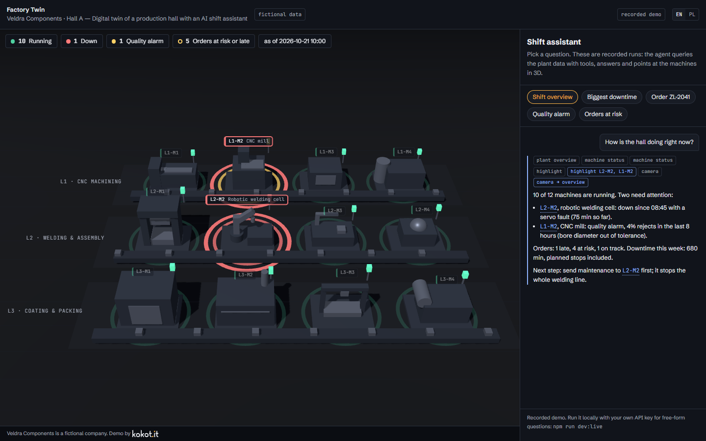
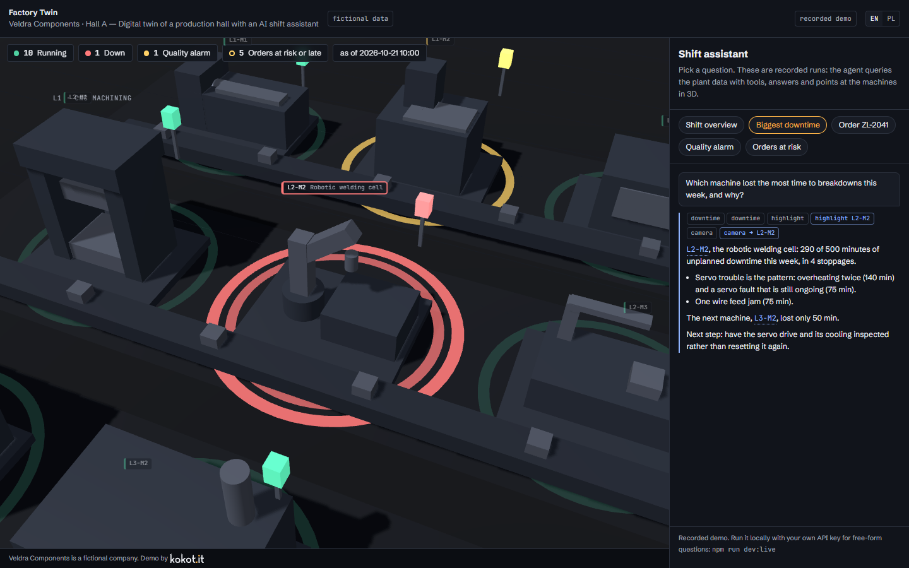
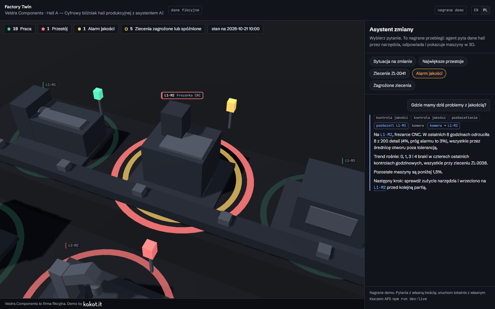
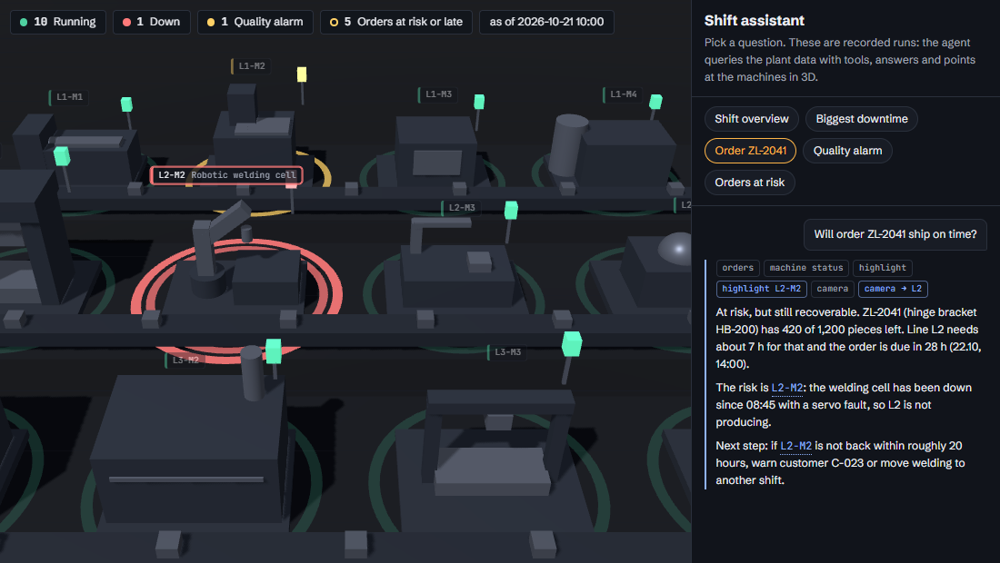
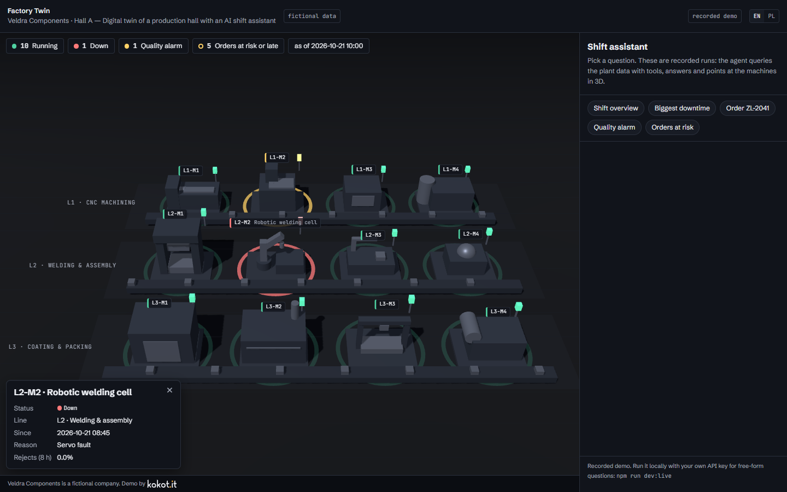
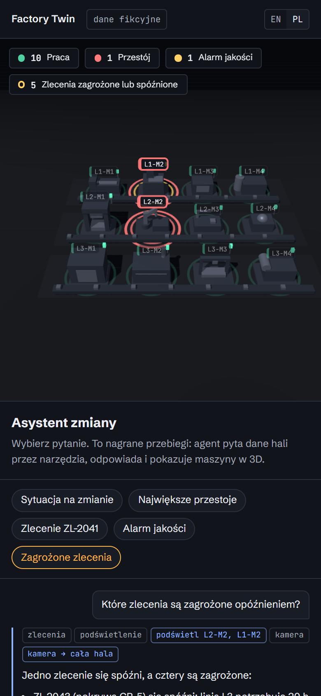

# Factory Twin

A 3D digital twin of a production hall with an AI shift assistant. Ask about orders, downtime or
quality; the agent queries the plant data with tools, answers in plain language and shows you the
machine in the scene: it highlights it and flies the camera there.

Demo project by [kokot.it](https://kokot.it). **All data is fictional**: Veldra Components, its
orders, customers (C-0xx codes) and machines do not exist.

> **PL:** Cyfrowy bliźniak hali produkcyjnej w 3D z asystentem AI dla kierownika zmiany. Agent
> odpowiada na pytania o zlecenia, przestoje i jakość, korzystając z narzędzi na danych hali, i
> pokazuje odpowiedź w scenie: podświetla maszynę i przenosi tam kamerę. Domyślnie działa jako
> nagrane demo (bez klucza API i bez serwera); lokalnie można go uruchomić z prawdziwym Claude.
> Interfejs i nagrania są po polsku i po angielsku (`?lang=pl`). Dane są w całości fikcyjne.



## The problem

In a small or mid-sized plant the answer to "why are we behind on ZL-2041?" is spread across the
MES or ERP, a downtime log and the quality sheets. It usually takes a walk around the hall and three
phone calls. This demo shows the alternative: one question, an answer built from the plant's own
numbers, and the machine in question lit up on a map of the hall.

## Demo

|                                                                                                 |                                                                   |
| ----------------------------------------------------------------------------------------------- | ----------------------------------------------------------------- |
|  |       |
| Biggest downtime: the agent sums a week of stoppages and flies to L2-M2                         | Quality alarm (Polish UI): the reject trend on the CNC mill       |
|                                 |  |
| `?embed=1`: no header or footer, made for an iframe                                             | Click any machine for its live status                             |



Five recorded scenarios ship in English and Polish: shift overview, biggest downtime, "will
ZL-2041 ship on time?", quality alarm, and orders at risk.

## Run it

Requires Node 22.12+ (developed on Node 24).

```bash
npm install
npm run dev          # recorded mode: no API key, no server; open http://localhost:5173
```

### Recorded mode (default)

`npm run dev` and the static build (`npm run build`, then serve `dist/`) replay the recorded
scenarios from `src/recordings/<lang>/*.json`. Nothing leaves the browser, and there is no cost.
Replays are deterministic: the same recording always produces the same timeline of tool calls,
scene actions and text.

### Live mode (your own Claude API key)

```bash
cp .env.example .env         # then put your key in ANTHROPIC_API_KEY
npm run dev:live             # http://localhost:5173, type any question
```

`dev:live` mounts `POST /api/chat` on the local Vite dev server (Node, bound to `localhost`). That
process holds the key and calls Claude through the official `@anthropic-ai/sdk` with tool use. The
browser only ever receives the finished transcript, never the key. Cross-origin requests to the
endpoint are refused, so another website cannot spend your key through your machine.

- Model: **`claude-opus-5-5`** (override with `FACTORY_TWIN_MODEL`), adaptive thinking, effort
  `medium`, server-side refusal fallback (`fallbacks: "default"`).
- At most 8 tool rounds per question. Invalid tool input goes back to Claude as `is_error`, so it
  can correct itself.

### Recording new scenarios

Scenario scripts live in `scenarios/*.json`: the question (EN/PL), the tool calls to make, and the
answer text.

```bash
npm run recordings:build     # rebuild scripted recordings, no model call
npm run record               # re-record every scenario live with Claude (needs .env)
npm run record -- --only quality-alarm --lang pl
```

- **Scripted** recordings (`"source": "scripted"`, `"model": null`) are what ships today. The tool
  results in them are the real output of the tools on the demo data; only the answer text is
  written by hand.
- **Live** recordings (`"source": "live"`, `"model": "<model id>"`) are captured from a real Claude
  run. `recordings:build` never overwrites them.

Either way, `npm test` re-runs every recorded tool call and fails if a result no longer matches
what the tool returns. Recordings cannot quietly drift from the data.

## Embedding (kokot.it case study page)

`npm run build` produces a static site in `dist/` with relative asset paths (`base: './'`), so it
works from any sub-path. No server is needed.

```html
<iframe
  src="/demos/factory-twin/index.html?embed=1&lang=pl"
  title="Factory Twin: digital twin of a production hall with an AI assistant"
  style="width: 100%; aspect-ratio: 16 / 9; border: 0"
  loading="lazy"
></iframe>
```

| Parameter             | Effect                                                                                                      |
| --------------------- | ----------------------------------------------------------------------------------------------------------- |
| `embed=1`             | hides the header and footer, tighter chat panel                                                             |
| `lang=en` / `lang=pl` | interface and recordings language (default: browser language, else English)                                 |
| `scenario=<id>`       | scenario to autoplay: `shift-overview`, `downtime-week`, `order-zl-2041`, `quality-alarm`, `orders-at-risk` |
| `autoplay=0`          | do not autoplay anything                                                                                    |

`<html data-chat="busy|idle">` reflects whether an answer is playing. The render loop pauses when
the tab is hidden or the iframe is scrolled out of view, the pixel ratio is capped at 1.75, and
`prefers-reduced-motion` turns off camera flights, animation and text reveal.

Everything ships in the bundle, including the fonts (self-hosted Schibsted Grotesk and JetBrains
Mono, SIL OFL 1.1). The page makes no third-party requests.

## Architecture

```
src/data/            plant.json + downtime.csv + quality.csv + orders.csv (fictional)
src/domain/          CSV parsing, plant clock, pure queries (status, downtime, quality, order risk)
src/agent/
  tools.ts           7 tools: 5 data queries + highlight_machines + focus_camera (shared by both modes)
  actions.ts         successful scene tool calls -> SceneAction[] (ids re-checked against the plant)
  player.ts          transcript -> deterministic timeline (fixed beats, no clock, no randomness)
  transcript.ts      transcript / recording types + schema check
src/recordings/      recorded transcripts, bundled at build time
src/scene/           Three.js hall: layout, primitive machine models, colours read from CSS tokens
src/ui/              chat panel, timeline runner, EN/PL strings
server/              live mode only: Claude tool-use loop, request validation, Vite middleware
scenarios/           scenario scripts used to build and record the recordings
scripts/             build-recordings, record-live, screenshots
```

One answer is one **transcript**: the question, then steps (`tool_call` with input and result, or
`text`). A recording is a stored transcript; a live answer is a fresh one from the server. Both
play through the same `buildTimeline()`, so recorded and live answers look identical. The agent
moves the scene only through its two scene tools, and those calls become `SceneAction`s that the
scene applies.

All numbers are relative to a fixed plant clock (`snapshot` in `plant.json`, 2026-10-21 10:00).
Plant time is handled as whole minutes without time zones, so every machine and browser computes
the same figures.

**Brand and design tokens:** `src/styles/tokens.css` is the kokot.it brand token file, copied
unchanged from the kokot-it repo (with `fonts.css`, the woff2 files and their OFL licences in
`src/assets/fonts/`, and the logo in `src/assets/brand/`). A short block at the end adds what
only this app needs (machine status and 3D hall colours, a few layout sizes), always through the
brand's own tokens. Running, down and quality-alarm machines use the brand's success, danger and
warning colours. What the agent points at is Ion. Signal (amber) is kept for calls to action and
focus. The 3D scene reads every colour from this file (`src/scene/tokens.ts`), and
`tests/brand-tokens.test.ts` pins the scene's colours to the brand palette, fails on any colour
literal outside `tokens.css`, and checks that nothing loads from Google Fonts. To pick up a newer
brand, copy the new file over the upper part and keep the app block.

## Quality checks

```bash
npm test          # Vitest (unit, DOM and HTTP-level tests)
npm run lint      # ESLint + Prettier
npm run typecheck
npm run build
npm run test:e2e  # builds, then browser smoke tests in headless Chromium (Playwright)
```

The tests cover:

- **Tools**: every figure is hand-computed from the CSVs (680 min of downtime this week, L2-M2 at
  290 min, L1-M2 at 8/200 = 4% rejects, ZL-2043 needing 20 h with 8 h left). Edge cases for each
  status and risk rule are tested on small purpose-built plants.
- **Tool calls to scene actions**: call order, failed calls, and forged ids in a recording.
- **Replay determinism**: identical timelines on repeated runs, no `Math.random` or `Date.now`, and
  reduced motion collapses all delays.
- **Recording consistency**: every recorded tool result equals today's tool output, and every
  highlighted machine is named in the answer.
- **Live loop** (against a fake SDK client): tool results returned in one message, `is_error` on
  bad input, refusal handling, round cap, request parameters.
- **`POST /api/chat`** on a real local HTTP server: 405, cross-origin 403, 415, 413 over 64 KiB,
  400, 503 without a key, 429/502 error mapping, no internal error text leaked.
- **Chat panel** (happy-dom): a live answer that arrives after the user switched to a recording
  is aborted and dropped; a malformed live answer never reaches the scene.
- **Browser smoke** (`test:e2e`): the static build plays a scenario without any `/api` request,
  embed mode, the 1.75 DPR cap, the render loop pausing in a hidden tab, and reduced motion
  playing the same answer with no delays.

## Limitations

- The data is a static snapshot, not a feed from a real MES, ERP or PLC. Wiring in real sources
  means replacing `src/data` loading with an adapter; the tools and everything above them stay the
  same.
- The shipped recordings are scripted (real tool results, hand-written answers), because they were
  produced without an API key. Run `npm run record` with a key to replace them with genuine Claude
  runs.
- Live mode is a local developer setup. There is no authentication and no rate limiting, so it is
  not meant to be exposed on the internet.
- The order-risk model is deliberately simple: a nominal rate per line, a due-date queue, and any
  stopped or alarming machine on the line marks its orders at risk.
- Machines are built from primitives, not CAD models.
- The 3D view needs WebGL.
