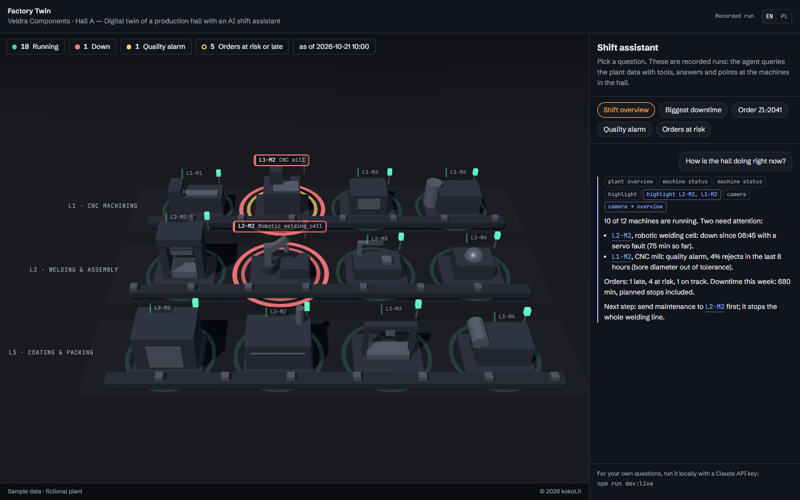
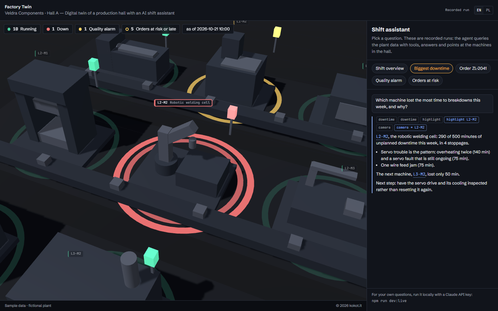
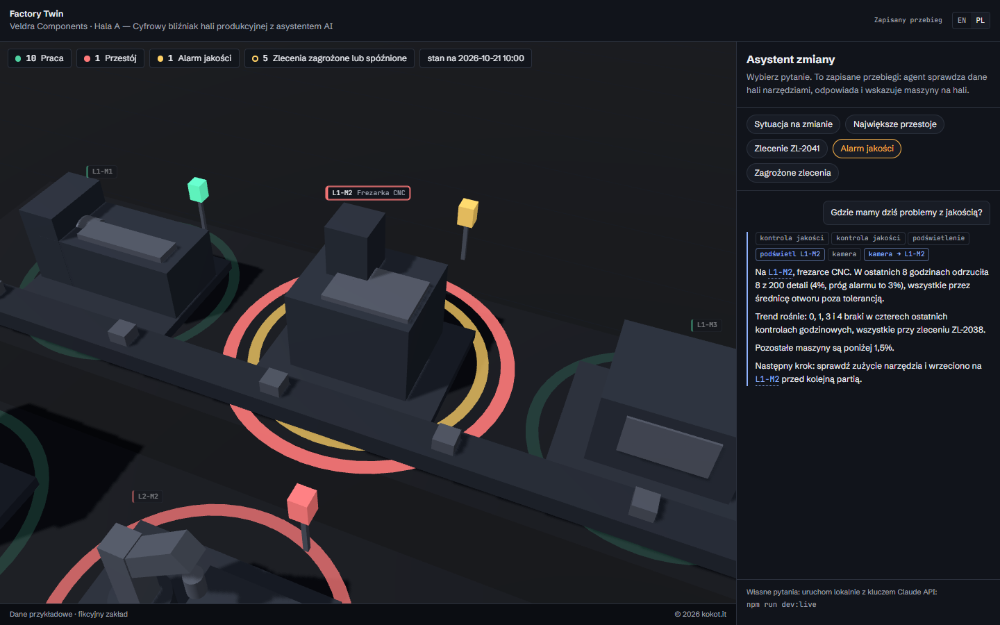
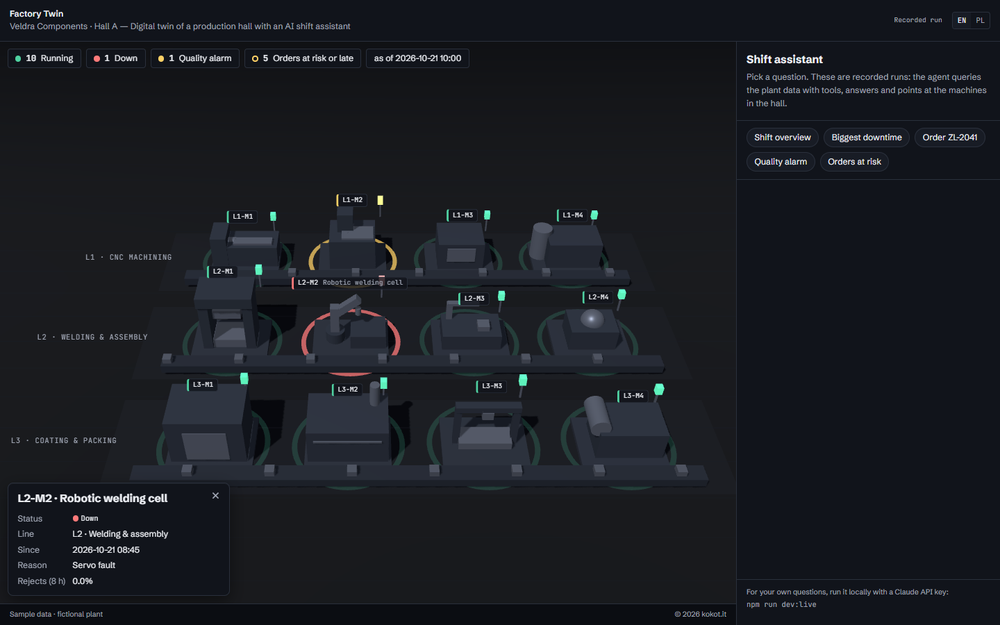
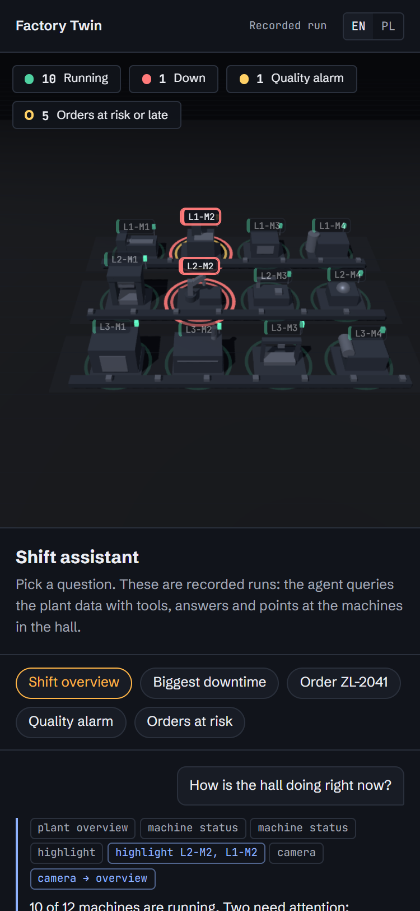
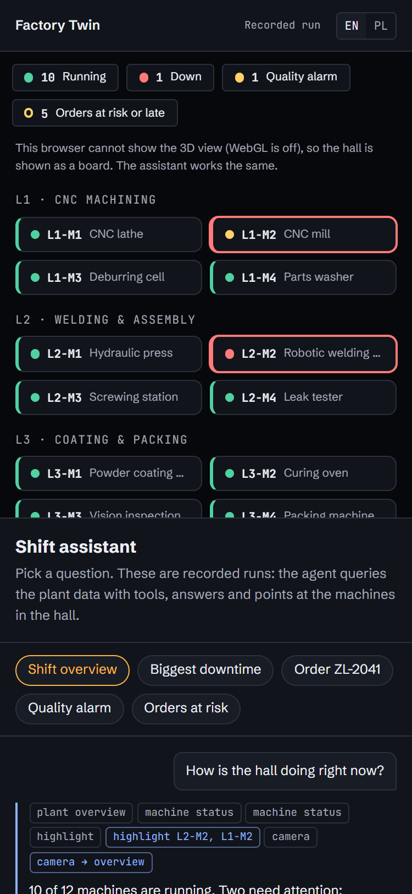
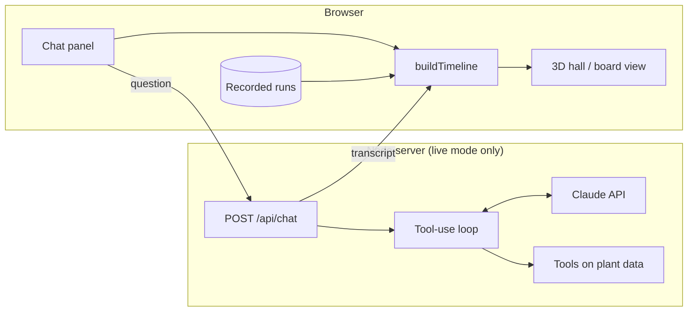

# Factory Twin

[](https://github.com/Aberratio/factory-twin/actions/workflows/ci.yml)
[](LICENSE)

A 3D digital twin of a production hall with an AI shift assistant built on Claude. Ask about
orders, downtime or quality: the agent queries the plant data with tools, answers in plain language
and shows you the machine in the hall, highlighting it and flying the camera there.

Built as a reference solution for plant managers and the teams building their tools: how an AI
agent can sit on top of production data without guessing a single number.

The interface and the recorded runs are available in English and Polish: switch with the EN/PL
buttons in the header, or set `?lang=en` / `?lang=pl` in the URL.



## Why

In a small or mid-sized plant the answer to "why are we behind on ZL-2041?" is spread across the
MES or ERP, a downtime log and the quality sheets. It usually takes a walk around the hall and
three phone calls. Factory Twin puts it behind one question: an answer built from the plant's own
numbers, and the machine in question lit up on a map of the hall.

## Features

- **Agent with tools, not guesses.** Seven tools: five data queries (overview, machine status,
  downtime, quality, orders) and two scene tools (highlight, camera). Every figure in an answer
  comes from a tool call.
- **The answer moves the scene.** Highlights and camera flights are tool calls too, so what the
  agent says and what the hall shows always match.
- **Two run modes.** A recorded, deterministic run (no key, no server, no cost) and live mode with
  your own Claude API key, server-side only.
- **Bilingual.** English and Polish interface and recorded runs.
- **Embeddable.** A static build with `?embed=1` for an iframe, a board view when WebGL is
  unavailable, reduced-motion support and no third-party requests.

|                                                                                                         |                                                                             |
| ------------------------------------------------------------------------------------------------------- | --------------------------------------------------------------------------- |
|  |  |
| Biggest downtime: the agent sums a week of stoppages and flies to L2-M2                                 | Quality alarm (Polish interface): the reject trend on the CNC mill          |
|                                         |    |
| `?embed=1`: no header or footer, made for an iframe                                                     | Click any machine for its current status                                    |

<p>
  
  &nbsp;
  
  &nbsp;
  
</p>

Five recorded scenarios ship in English and Polish: shift overview, biggest downtime, "will
ZL-2041 ship on time?", quality alarm, and orders at risk.

## Architecture



One answer is one **transcript**: the question, then tool calls and text. A recorded run is a
stored transcript; a live answer is a fresh one from the server. Both play through the same
timeline builder, so they look identical. The agent moves the scene only through its two scene
tools, and every machine id is re-checked against the plant before the scene applies it.

```
src/data/       plant.json + downtime.csv + quality.csv + orders.csv (sample data)
src/domain/     CSV parsing, plant clock, pure queries (status, downtime, quality, order risk)
src/agent/      tools (shared by both modes), tool calls -> scene actions, deterministic player
src/recordings/ recorded transcripts, bundled at build time
src/scene/      Three.js hall and the no-WebGL board view; colours read from CSS tokens
src/ui/         chat panel, EN/PL strings
server/         live mode only: Claude tool-use loop, request validation, Vite middleware
scenarios/      scenario scripts used to build and record the recordings
scripts/        build-recordings, record-live, screenshots, check-wording
```

The reasoning behind the main choices is in [docs/architecture.md](docs/architecture.md).

## Quick start

Requires Node 22.12+ (developed on Node 24).

```bash
npm ci
npm run dev          # recorded run: no API key, no server; open http://localhost:5173
```

### Recorded run (default)

`npm run dev` and the static build (`npm run build`, then serve `dist/`) replay the recorded
scenarios from `src/recordings/<lang>/*.json`. Nothing leaves the browser and there is no cost.
Replays are deterministic: the same recording always produces the same timeline of tool calls,
scene actions and text.

### Live (Claude API)

```bash
cp .env.example .env         # then put your key in ANTHROPIC_API_KEY
npm run dev:live             # http://localhost:5173, type any question
```

`dev:live` mounts `POST /api/chat` on the local Vite dev server (Node, bound to `localhost`). That
process holds the key and calls Claude through the official `@anthropic-ai/sdk` with tool use:
model `claude-opus-5-5` by default, adaptive thinking, at most 8 tool rounds per question. Invalid
tool input goes back to Claude as `is_error`, so it can correct itself.

## Configuration

| Variable                   | Default           | Purpose                                                         |
| -------------------------- | ----------------- | --------------------------------------------------------------- |
| `ANTHROPIC_API_KEY`        | (none)            | Claude API key for live mode and `npm run record`. Server-only. |
| `FACTORY_TWIN_MODEL`       | `claude-opus-5-5` | Model used in live mode.                                        |
| `FACTORY_TWIN_SKIP_DOTENV` | (unset)           | `1` stops `vite.config.ts` from reading `.env` (used by tests). |

URL parameters:

| Parameter             | Effect                                                                                                      |
| --------------------- | ----------------------------------------------------------------------------------------------------------- |
| `embed=1`             | hides the header and footer, tighter chat panel                                                             |
| `lang=en` / `lang=pl` | interface and recordings language (default: browser language, else English)                                 |
| `scenario=<id>`       | scenario to autoplay: `shift-overview`, `downtime-week`, `order-zl-2041`, `quality-alarm`, `orders-at-risk` |
| `autoplay=0`          | do not autoplay anything                                                                                    |
| `webgl=0`             | show the board view used when WebGL is unavailable                                                          |

### Embedding

`npm run build` produces a static site in `dist/` with relative asset paths (`base: './'`), so it
works from any sub-path. No server is needed.

```html
<iframe
  src="/factory-twin/index.html?embed=1&lang=pl"
  title="Factory Twin: digital twin of a production hall with an AI assistant"
  style="width: 100%; aspect-ratio: 16 / 9; border: 0"
  loading="lazy"
></iframe>
```

`<html data-chat="busy|idle">` reflects whether an answer is playing. The render loop pauses when
the tab is hidden or the iframe is scrolled out of view, the pixel ratio is capped at 1.75, and
`prefers-reduced-motion` turns off camera flights, animation and text reveal. Fonts (Schibsted
Grotesk and JetBrains Mono, SIL OFL 1.1) are self-hosted; the page makes no third-party requests.

### Recording new scenarios

Scenario scripts live in `scenarios/*.json`: the question (EN/PL), the tool calls to make, and the
answer text.

```bash
npm run recordings:build     # rebuild scripted recordings, no model call
npm run record               # re-record every scenario live with Claude (needs .env)
npm run record -- --only quality-alarm --lang pl
```

- **Scripted** recordings (`"source": "scripted"`, `"model": null`) are what ships today. Their
  tool results are the real output of the tools on the sample data; only the answer text is
  written by hand.
- **Live** recordings (`"source": "live"`, `"model": "<model id>"`) are captured from a real Claude
  run. `recordings:build` never overwrites them.

Either way, `npm test` re-runs every recorded tool call and fails if a result no longer matches
what the tool returns, so recordings cannot drift from the data.

## Tests and quality

```bash
npm test               # 245 unit, DOM and HTTP-level tests (Vitest)
npm run lint           # ESLint + Prettier
npm run typecheck
npm run build
npm run check:wording  # copy check over the built site and the docs
npm run check:language # English everywhere except the Polish UI strings and sample data
npm run test:e2e       # builds, then 7 browser tests in headless Chromium (Playwright)
```

CI runs all of them on every push and pull request. The tests cover:

- **Tools**: every figure is hand-computed from the CSVs (680 min of downtime this week, L2-M2 at
  290 min, L1-M2 at 8/200 = 4% rejects, ZL-2043 needing 20 h with 8 h left), plus edge cases for
  each status and risk rule on small purpose-built plants.
- **Replay determinism**: identical timelines on repeated runs, no `Math.random` or `Date.now`,
  and reduced motion collapses all delays.
- **Recording consistency**: every recorded tool result equals today's tool output, and every
  highlighted machine is named in the answer.
- **Live loop** against a fake SDK client: tool results, `is_error` on bad input, refusals, the
  round cap and request parameters.
- **`POST /api/chat`** on a real local HTTP server: 405, cross-origin 403, 415, 413 over 64 KiB,
  400, 503 without a key, 429/502 error mapping, no internal error text leaked.
- **Browser tests**: the static build plays a scenario without any `/api` request, embed mode, the
  pixel-ratio cap, the render loop pausing in a hidden tab, and reduced motion.
- **Brand**: the scene's colours are pinned to the brand palette, and no colour literal lives
  outside `tokens.css`.

## Security

- The Claude API key lives only in `.env` on the machine running the Node server. It is never
  prefixed with `VITE_`, never bundled and never sent to the browser; the browser receives only the
  finished transcript.
- `/api/chat` refuses cross-origin browser requests, caps the request body at 64 KiB and validates
  every field. Error responses carry fixed messages; details stay in the server log.
- The recorded run and the static build make no network requests beyond their own assets.
- Live mode is a local developer setup without authentication or rate limiting. Do not expose it on
  the public internet as is.

## Data

All data is sample data. **Veldra Components, its plant, machines, orders, customers (C-0xx codes),
downtime and quality records are fictional** and do not describe any real company or deployment.

The data is a static snapshot, not a feed from a real MES, ERP or PLC. Connecting real sources
means replacing the `src/data` loading with an adapter; the tools and everything above them stay
the same.

## Limitations

- The shipped recordings are scripted (real tool results, hand-written answers). Run
  `npm run record` with a key to replace them with Claude runs.
- The order-risk model is deliberately simple: a nominal rate per line, a due-date queue, and any
  stopped or alarming machine on the line marks its orders at risk.
- Machines are built from primitives, not CAD models.

## License

[MIT](LICENSE) © 2026 Joanna Kokot. Fonts: SIL Open Font License 1.1 (see `src/assets/fonts/`).

## Author

Built by [kokot.it](https://kokot.it): AI and agentic engineering for manufacturing and software
teams.
